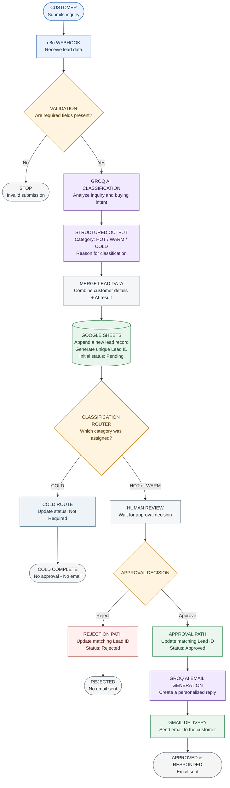

# System Architecture

This document explains the complete lead-management workflow, from the first customer submission to each possible outcome. The diagram separates the common processing stages from the COLD and human-approval routes so the decisions and connections are easy to trace.

## End-to-End Workflow

## Workflow Stages

1. **Lead reception:** The n8n Webhook receives the customer's name, email, budget and inquiry message.
2. **Validation:** Required fields are checked. Invalid submissions stop before AI classification.
3. **AI classification:** Groq analyzes the inquiry and returns a structured category (HOT, WARM or COLD) with a reason.
4. **Lead record creation:** Customer data and AI output are combined. Google Sheets stores the lead with a unique Lead ID and an initial Pending status.
5. **Category routing:**
   - **HOT / WARM:** The workflow pauses and waits for a human decision.
   - **COLD:** The record is updated to Not Required and finishes without approval or email.
6. **Human decision:**
   - **Reject:** The matching record is updated to Rejected. No email is sent.
   - **Approve:** The matching record is updated to Approved, then the workflow continues to email generation.
7. **Email delivery:** Groq generates a personalized reply and Gmail sends it to the customer after approval.

## Main Components

| Component | Responsibility |
|---|---|
| n8n Webhook | Receives customer lead submissions |
| Validation (IF) | Checks required customer fields |
| Groq AI + Structured Output Parser | Classifies the lead and returns structured output |
| Merge | Combines original lead details with the AI result |
| Google Sheets | Stores each inquiry, unique Lead ID, category and status |
| Switch | Routes HOT, WARM and COLD leads |
| Wait + approval logic | Pauses HOT/WARM leads for human review |
| Groq AI email generation | Creates the personalized customer reply |
| Gmail | Sends the approved email |

## Data and Routing Rules

- Each inquiry receives its own unique Lead ID, so repeat inquiries from the same email address remain separate records.
- Google Sheets is updated using the unique Lead ID, not the customer's email address.
- New lead records are stored with the initial status **Pending**.
- HOT and WARM leads wait for a human approval decision.
- COLD leads are marked **Not Required** and bypass approval.
- Rejected leads are marked **Rejected** and do not trigger an email.
- Only approved leads proceed to AI email generation and Gmail delivery.

## Security Considerations

- Keep API credentials inside n8n credentials; never commit secrets to this repository.
- Do not publish production webhook URLs, approval tokens, resume URLs or private customer data.
- Protect approval endpoints with authentication and rotate any credential that may have been exposed.
- Restrict access to connected Google Sheets and Gmail accounts.
- Review execution logs and test failure paths before production use.
