# System Architecture

This page shows the actual lead-processing path from customer submission to the final outcome. The diagram is kept intentionally linear so each connection is easy to follow.

## End-to-End Workflow

```mermaid
%%{init: {"flowchart": {"curve": "linear", "nodeSpacing": 42, "rankSpacing": 58}}}%%
flowchart LR
    A(["Customer<br/>submits lead"]) --> B["n8n Webhook"]
    B --> C{"Required fields<br/>valid?"}

    C -->|No| X(["Stop<br/>Invalid lead"])
    C -->|Yes| D["Groq AI<br/>Classify lead"]
    D --> E["Structured output<br/>HOT · WARM · COLD"]
    E --> F["Merge lead data<br/>with AI result"]
    F --> G[("Google Sheets<br/>Append lead + unique ID<br/>Initial status: Pending")]
    G --> H{"Lead<br/>category?"}

    H -->|COLD| I["Update status<br/>Not Required"]
    I --> J(["Finished<br/>No email"])

    H -->|HOT or WARM| K["Wait for<br/>human decision"]
    K --> L{"Approval<br/>decision?"}

    L -->|Reject| M["Update matching row<br/>Status: Rejected"]
    M --> N(["Finished<br/>No email"])

    L -->|Approve| O["Update matching row<br/>Status: Approved"]
    O --> P["Groq AI<br/>Generate email"]
    P --> Q["Gmail<br/>Send personalized email"]
    Q --> R(["Finished<br/>Email sent"])

    classDef input fill:#edf4ff,stroke:#5279ad,color:#172b4d,stroke-width:1.5px
    classDef ai fill:#f3edff,stroke:#8665b5,color:#35204f,stroke-width:1.5px
    classDef storage fill:#eaf5ee,stroke:#4e8b67,color:#193c29,stroke-width:1.5px
    classDef decision fill:#fff5e3,stroke:#c28b35,color:#50380e,stroke-width:1.5px
    classDef outcome fill:#f1f3f5,stroke:#778391,color:#27323c,stroke-width:1.3px

    class B,C,F,K,O,M input
    class D,E,P ai
    class G storage
    class H,L decision
    class A,X,J,N,R,I,Q outcome
```

## How the Workflow Operates

1. **Receive and validate:** The n8n Webhook receives the inquiry. Required fields are checked before processing continues.
2. **Classify with AI:** Groq analyzes the inquiry and returns a structured HOT, WARM, or COLD category with a reason.
3. **Create the lead record:** The original lead data and AI result are merged and appended to Google Sheets. Each inquiry receives its own unique Lead ID.
4. **Route by category:**
   - **HOT / WARM:** The record remains Pending while the workflow waits for a human approval decision.
   - **COLD:** The record is marked Not Required and finishes without entering the approval or email path.
5. **Apply the human decision:** The matching Google Sheets row is updated by its unique Lead ID. Rejected leads finish without an email.
6. **Send the approved response:** Only an approved lead proceeds to AI email generation and Gmail delivery.

## Main Components

| Component | Responsibility |
|---|---|
| n8n | Orchestrates the workflow and connects the services |
| Webhook | Receives customer lead submissions |
| Groq AI | Classifies leads and generates personalized email content |
| Structured Output Parser | Structures the AI classification result |
| Google Sheets | Stores lead details, category, unique ID, and status |
| Wait / approval logic | Pauses HOT and WARM leads for human review |
| Gmail | Sends the email after approval |

## Important Data and Control Rules

- Every inquiry receives a unique Lead ID. Multiple inquiries from the same email address are stored as separate records.
- Approval and rejection update the row matching that Lead ID, not every row with the same email address.
- HOT and WARM leads require human approval.
- COLD leads bypass human approval and are marked Not Required.
- The automated email is sent only after approval.

## Security Considerations

- Store API credentials in n8n credentials; never commit secrets to this repository.
- Do not publish production webhook URLs, approval tokens, or private customer data.
- Protect approval endpoints with authentication and rotate any credential that may have been exposed.
- Restrict access to connected Google Sheets and Gmail accounts.
- Review execution logs and test failure paths before production use.
