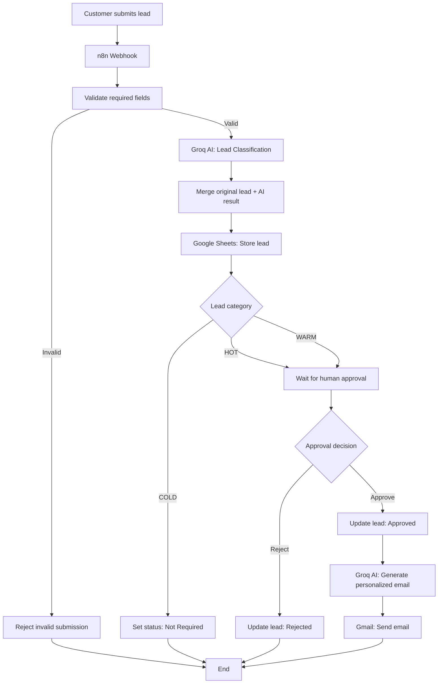

# System Architecture

This document explains how the AI-Powered Lead Management System processes customer inquiries, classifies leads, manages human approval, and sends personalized email responses.

## Architecture Diagram

## Workflow Stages

1. **Lead reception:** An n8n Webhook receives a customer inquiry.
2. **Validation:** Required fields are checked. Invalid submissions are rejected from further processing.
3. **AI classification:** Groq analyzes the inquiry and returns a structured HOT, WARM, or COLD category with a reason.
4. **Lead storage:** The original lead information and AI classification are combined and saved to Google Sheets with a unique Lead ID.
5. **Intelligent routing:**
   - HOT and WARM leads wait for a human decision.
   - COLD leads are recorded with the status `Not Required` and bypass approval.
6. **Human approval:** An authorized approval or rejection decision updates the matching Google Sheets record using its unique Lead ID.
7. **Email delivery:** Only approved leads proceed to AI-generated personalized email creation and Gmail delivery. Rejected leads do not receive the automated email.

## Main Components

| Component | Responsibility |
|---|---|
| n8n | Orchestrates the automation workflow |
| Webhook | Receives incoming lead data and approval decisions |
| Groq AI | Classifies leads and generates personalized email content |
| Structured Output Parser | Helps produce structured classification output |
| Google Sheets | Stores lead details, category, and status |
| Wait / approval logic | Pauses HOT and WARM leads for human review |
| Gmail | Sends the email after approval |

## Security Considerations

- Keep API credentials in n8n credentials; never commit secrets to this repository.
- Do not publish production webhook URLs, approval tokens, or private customer data.
- Protect approval endpoints with authentication and rotate exposed credentials.
- Validate incoming data and review execution logs for failures.
- Apply appropriate access controls to connected Google Sheets and Gmail accounts.

## Important Behaviour

- Each inquiry receives a unique Lead ID so multiple inquiries from the same email address can be tracked separately.
- Approval and rejection updates target the matching Lead ID.
- COLD leads bypass human approval.
- Automated customer email is sent only after approval.
