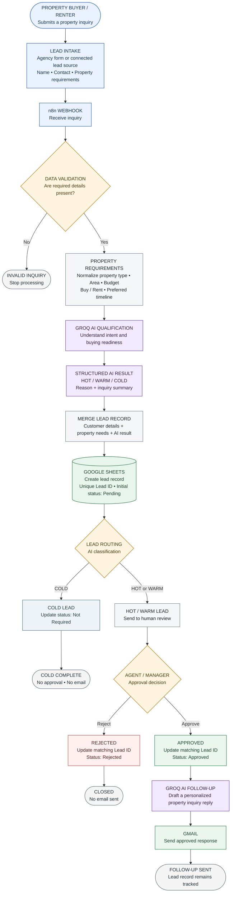

# Real Estate Lead Management — System Architecture

This document presents one end-to-end architecture for deploying the AI Lead Management System with a real estate agency. It maps the existing automation pattern to property-buyer and renter inquiries. Property-specific form fields and client integrations are configured during each agency's onboarding.

## Complete Lead Journey

## How the Real Estate Workflow Works

1. **Capture the inquiry:** A buyer or renter submits their contact details and property requirements through the agency's form or a connected lead source.
2. **Validate the submission:** n8n checks that the required information is present before processing.
3. **Understand property needs:** The client intake is organized around property type, preferred area, budget, buying or renting intent, and expected timeline. The exact fields are agreed with the agency.
4. **Qualify with AI:** Groq analyzes the inquiry and returns a structured HOT, WARM or COLD category with a reason and concise summary.
5. **Save the lead:** Customer information and AI output are combined and saved in Google Sheets with a unique Lead ID and an initial Pending status.
6. **Route the lead:**
   - **HOT / WARM:** Sent for agent or manager review. The workflow waits for an approval decision.
   - **COLD:** Updated to Not Required and exits without approval or automated email.
7. **Apply the decision:**
   - **Reject:** Update the matching Lead ID to Rejected. No email is sent.
   - **Approve:** Update the matching Lead ID to Approved and continue.
8. **Send the response:** Groq drafts a personalized reply based on the inquiry. Gmail sends it after approval.

## Client Configuration

The core workflow can be reused, while each real estate agency receives its own configuration:

| Configuration | Example |
|---|---|
| Property type | Apartment, house, plot, commercial |
| Inquiry intent | Buying, renting, selling, investment |
| Preferred area | Agency's supported locations |
| Budget | Client's currency and price ranges |
| Buying / rental timeline | Immediate, within 1–3 months, researching |
| Lead source | Agency website form or agreed connected source |
| Lead database | Dedicated client Google Sheet |
| Email delivery | Client-authorized Gmail account |
| Approval owner | Assigned agent or sales manager |

The property-specific fields above are the real-estate deployment configuration. They should be added to the intake form, validation and AI prompt when adapting the reusable workflow for a client.

## Core Components

| Component | Responsibility |
|---|---|
| Lead form / connected source | Collects property inquiry details |
| n8n Webhook | Receives the inquiry |
| Validation | Checks required fields |
| Groq AI + Structured Output Parser | Classifies the inquiry and returns structured information |
| Merge | Combines lead data and AI result |
| Google Sheets | Stores each inquiry, unique Lead ID, category and status |
| Switch | Routes HOT, WARM and COLD leads |
| Wait + approval logic | Pauses HOT/WARM leads for agent review |
| Groq AI email generation | Drafts a personalized follow-up |
| Gmail | Sends the approved email |

## Lead Status and Control Rules

- Each inquiry receives a unique Lead ID. Repeat inquiries from the same contact remain separate records.
- New inquiries are saved with status **Pending**.
- Updates target the matching Lead ID, not every row with the same email address.
- HOT and WARM leads wait for a human decision.
- COLD leads are marked **Not Required** and bypass approval.
- Rejected leads are marked **Rejected** and do not trigger an email.
- Only approved leads proceed to AI email generation and Gmail delivery.

## Security and Client Isolation

- Use a separate client configuration and dedicated data destination for each agency.
- Connect each agency's own Google and email accounts using securely stored credentials.
- Never share customer records, credentials, approval tokens or webhook URLs between clients.
- Keep API credentials in n8n credentials; do not commit secrets or private customer data to this repository.
- Protect webhook and approval endpoints with authentication.
- Restrict access to client sheets and execution history.
- Test failure paths and confirm client authorization before going live.
