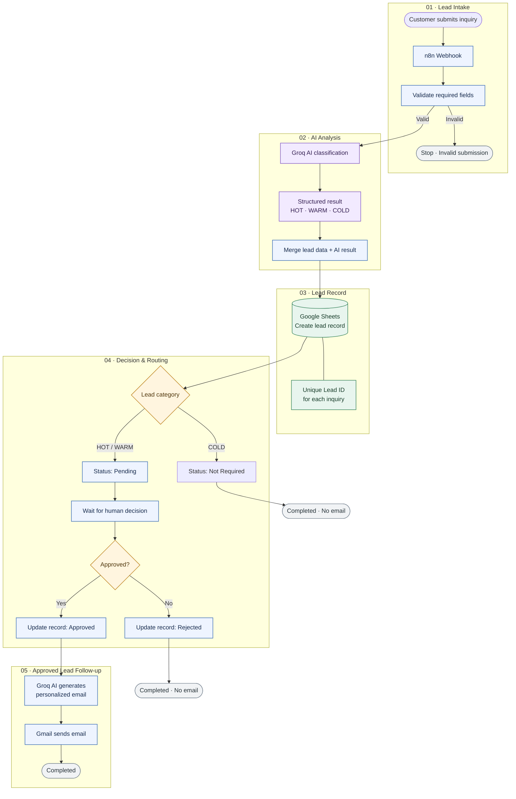

# System Architecture

This document describes the end-to-end flow of the AI-Powered Lead Management System, from lead submission through AI classification, human review, and customer email delivery.

## Architecture Diagram

## Process Breakdown

| Stage | What happens |
|---|---|
| Lead intake | The webhook receives a customer inquiry and required fields are validated. |
| AI analysis | Groq classifies the inquiry as HOT, WARM, or COLD and returns a structured result with a reason. |
| Lead record | The lead and AI result are combined and stored in Google Sheets. Each inquiry receives a unique Lead ID. |
| Routing | HOT and WARM leads enter human approval. COLD leads are marked `Not Required` and bypass approval. |
| Human decision | Approval or rejection updates the correct row using the unique Lead ID. |
| Email delivery | Only approved leads proceed to AI email generation and Gmail delivery. Rejected and COLD leads do not receive this automated email. |

## Technology Components

| Component | Role |
|---|---|
| n8n | Orchestrates the complete workflow |
| Webhook | Receives lead submissions and approval decisions |
| Groq AI | Performs lead classification and personalized email generation |
| Structured Output Parser | Structures the classification response |
| Google Sheets | Stores lead details, category, and status |
| Wait and approval logic | Keeps HOT and WARM leads pending for human review |
| Gmail | Delivers the email after approval |

## Key Design Decisions

- **Human-in-the-loop:** AI classifies and drafts; a person makes the approval decision.
- **Unique record matching:** Updates use the Lead ID, so multiple inquiries from one email address remain separate.
- **Controlled email delivery:** The automated email path is available only after approval.
- **Clear outcomes:** Rejected and COLD leads finish without the approval email.

## Security Considerations

- Store API credentials in n8n credentials; never commit secrets to this repository.
- Do not publish production webhook URLs, approval tokens, or private customer data.
- Protect approval endpoints with authentication and rotate any credential that may have been exposed.
- Restrict access to connected Google Sheets and Gmail accounts.
- Review execution logs and test failure paths before production use.
