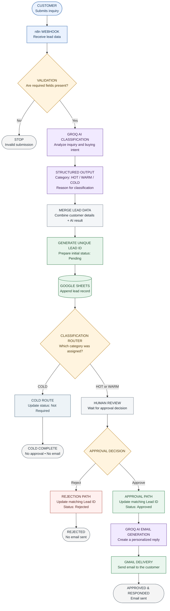

# System Architecture

This document describes the implemented n8n lead-management workflow, from the first customer submission to each possible outcome. The diagram separates shared processing from the COLD and human-approval routes.

## End-to-end workflow

## Workflow stages

1. **Lead reception:** The n8n Webhook receives the customer's name, email, budget and inquiry message.
2. **Validation:** Required fields are checked. Invalid submissions stop before AI classification.
3. **AI classification:** Groq analyzes the inquiry and returns a structured category (HOT, WARM or COLD) with a reason.
4. **Lead preparation:** The original customer data and AI result are combined. A unique Lead ID is generated in the workflow before the record is appended to Google Sheets.
5. **Lead record creation:** Google Sheets stores the lead with its unique Lead ID and initial `Pending` status.
6. **Category routing:**
   - **HOT / WARM:** The workflow pauses and waits for a human decision.
   - **COLD:** The record is updated to `Not Required` and finishes without approval or email.
7. **Human decision:**
   - **Reject:** The matching record is updated to `Rejected`. No email is sent.
   - **Approve:** The matching record is updated to `Approved`, then the workflow continues to email generation.
8. **Email delivery:** Groq generates a personalized reply and Gmail sends it after approval.

## Main components

| Component | Responsibility |
|---|---|
| n8n Webhook | Receives customer lead submissions |
| Validation (IF) | Checks required customer fields |
| Groq AI + Structured Output Parser | Classifies the lead and returns structured output |
| Merge | Combines original lead details with the AI result |
| Edit Fields / lead preparation | Generates the unique Lead ID and prepares lead data |
| Google Sheets | Stores each inquiry, category, Lead ID and status |
| Switch | Routes HOT, WARM and COLD leads |
| Wait + approval logic | Pauses HOT/WARM leads for human review |
| Groq AI email generation | Creates the personalized customer reply |
| Gmail | Sends the approved email |

## Data and routing rules

- Each inquiry receives its own unique Lead ID, so repeat inquiries from the same email address remain separate records.
- The Lead ID is generated in the workflow before Google Sheets appends the row.
- Google Sheets updates match the unique Lead ID, not the customer's email address.
- New lead records are stored with the initial status **Pending**.
- HOT and WARM leads wait for a human approval decision.
- COLD leads are marked **Not Required** and bypass approval.
- Rejected leads are marked **Rejected** and do not trigger an email.
- Only approved leads proceed to AI email generation and Gmail delivery.

## Security and production considerations

This diagram describes the workflow's functional path, not a complete production security architecture. Before deployment:

- Keep API credentials inside n8n credentials; never commit secrets.
- Do not publish production webhook URLs, approval tokens, Wait resume URLs or private customer data.
- Use strong authentication for externally reachable lead and approval endpoints.
- Rotate any credential or approval token that may have been exposed.
- Restrict access to connected Google Sheets and Gmail accounts.
- Add monitoring and failure notifications, and test retries and duplicate-processing behavior.
- Review privacy, retention and client access requirements before processing real customer data.

See [Security and Deployment Checklist](security-and-deployment.md) for the deployment review.
