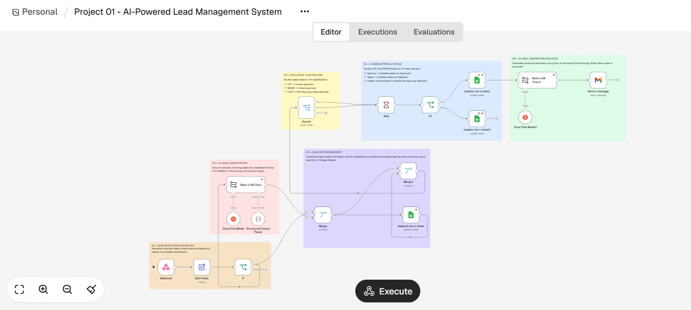

# AI-Powered Lead Management System

An AI-assisted lead qualification and follow-up workflow built with **n8n, Groq, Google Sheets and Gmail**. It receives customer inquiries, validates required fields, classifies buying intent, routes leads for human review and sends an AI-generated reply only after approval.

## Project at a glance

| | |
|---|---|
| **Category** | AI Automation · Lead Management · Human-in-the-Loop |
| **Automation** | n8n |
| **AI** | Groq |
| **Lead records** | Google Sheets |
| **Email delivery** | Gmail |
| **Input** | n8n Webhook |
| **Demo** | [Watch the 1 min 28 sec walkthrough](Demo/AI_Lead_Management_Demo.mp4) |

## Demo

[](Demo/AI_Lead_Management_Demo.mp4)

**[Watch the narrated video walkthrough](Demo/AI_Lead_Management_Demo.mp4)** · [Demo details](Demo/README.md)

The walkthrough shows lead intake, AI classification, approval routing, Google Sheets status tracking and Gmail follow-up.

## What it does

1. **Receives inquiries** through an n8n webhook.
2. **Validates required fields** before sending data to the AI model.
3. **Classifies buying intent** as HOT, WARM or COLD and returns a reason using structured AI output.
4. **Creates a unique Lead ID** and stores the lead and classification in Google Sheets with an initial `Pending` status.
5. **Routes the lead** according to its classification:
   - **HOT / WARM:** pauses for a human approval decision.
   - **COLD:** updates the record to `Not Required` and ends without sending an email.
6. **Handles the human decision:**
   - **Approve:** updates the matching record to `Approved`, generates a personalized reply with Groq and sends it through Gmail.
   - **Reject:** updates the matching record to `Rejected` and does not send an email.

## Workflow architecture

The diagram below shows the implemented workflow at a logical level. The unique Lead ID is generated in the workflow before the Google Sheets append operation.

[**Read the detailed architecture and routing documentation**](Documentation/architecture.md)

## Technology stack

| Technology | Role |
|---|---|
| n8n | Workflow orchestration, webhooks, validation, routing and approval wait |
| Groq | Lead classification and personalized email generation |
| Structured Output Parser | Enforces a structured classification result |
| Google Sheets | Lead records and status tracking |
| Gmail | Sends approved customer follow-ups |

## Validation and test coverage

The workflow has been manually tested for the following scenarios:

- Valid lead submission.
- Missing name, email, message or budget.
- Zero-budget submission.
- HOT, WARM and COLD routing.
- HOT / WARM approval and rejection.
- COLD status update without approval or email.
- Unique Lead ID generation.
- Multiple inquiries from the same email address.
- Updating the correct Google Sheets row by Lead ID.
- AI-generated Gmail delivery after approval.

These are documented manual workflow tests, not an automated software test suite.

## Repository contents

```text
.
├── README.md
├── Demo/
│   ├── README.md
│   └── AI_Lead_Management_Demo.mp4
├── Documentation/
│   ├── architecture.md
│   └── security-and-deployment.md
└── Screenshots/
    ├── 00-workflow-overview.png
    ├── 01-successful-execution.png
    ├── 02-google-sheets.png
    └── 03-gmail-confirmation.png
```

## Screenshots

### Workflow overview


### Successful execution


### Google Sheets lead record


### Gmail confirmation


## Project status and scope

The core workflow is implemented and has passed the manual scenarios listed above. This repository contains its documentation, screenshots and narrated demonstration; it does **not** currently include a sanitized, importable n8n workflow export or a one-click deployment package.

The project is a working portfolio demonstration, not a production-ready multi-tenant service. Before using it with a business, configure that client's fields, prompts, credentials, Google Sheet and email content; review the security checklist; and test failure handling in the target environment.

**Current integration scope:** webhook-based lead intake, Groq, Google Sheets, n8n human approval and Gmail. Direct Facebook Lead Ads, WhatsApp, property portals, CRM integrations, centralized alerting and multi-client isolation are not included in this version.

See [Security and Deployment Checklist](Documentation/security-and-deployment.md) for the pre-deployment review.

## Contact

For freelance automation projects, collaboration or questions:

- **Email:** [mbm28204@gmail.com](mailto:mbm28204@gmail.com)
- **WhatsApp:** [Chat with me](https://wa.me/923213490887)

