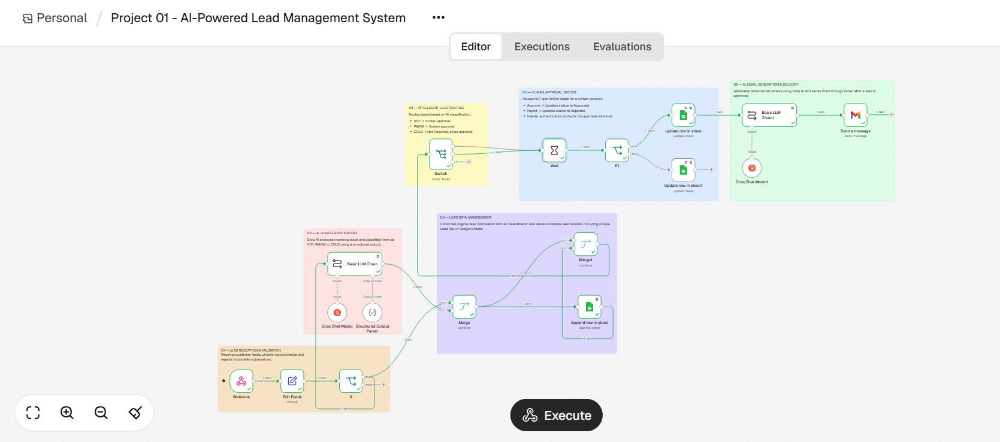
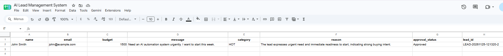
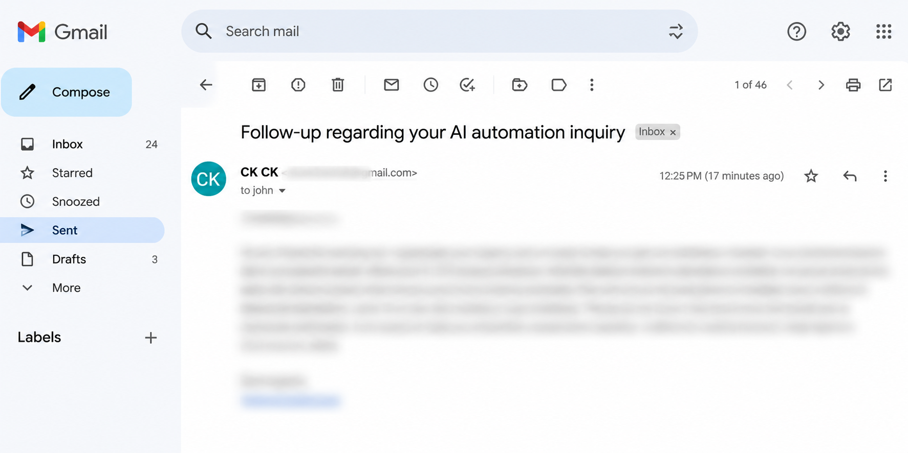

# Project 01 — AI-Powered Lead Management System

## Project Overview

An AI-powered lead management automation system built with n8n. It automatically receives customer inquiries, analyzes their buying intent, categorizes leads, manages human approval, stores customer information and sends personalized emails to approved leads.

## Problem It Solves

Businesses often manage customer inquiries manually. This can lead to:
- Slow lead responses.
- Missed sales opportunities.
- Poor lead prioritization.
- Repetitive administrative work.
- Disorganized customer records.

This automation reduces manual work and creates a structured lead management process.

## Technologies Used

| Technology | Purpose |
|---|---|
| n8n | Workflow automation |
| Groq AI | AI-powered lead classification and email generation |
| Google Sheets | Lead database and status tracking |
| Gmail | Personalized email delivery |
| Webhooks | Receive leads and approval decisions |
| Structured Output Parser | Structured AI classification |

## Main Features

1. Automatic lead collection through webhooks.
2. Required-field validation.
3. AI classification into HOT, WARM and COLD.
4. Unique Lead ID generation.
5. Automatic Google Sheets storage.
6. Intelligent lead routing.
7. Human approval and rejection system.
8. Approval endpoint using Header Authentication.
9. AI-generated personalized emails.
10. Gmail email delivery after approval.
11. Automatic retry settings for selected AI and Google Sheets nodes.

## Workflow Architecture

### 01 — Lead Reception & Validation
Receives customer information and checks required fields.

### 02 — AI Lead Classification
Groq AI analyzes customer inquiries and assigns a HOT, WARM or COLD category.

### 03 — Lead Data Management
Combines original customer information with AI classification and stores the complete record in Google Sheets.

### 04 — Intelligent Lead Routing
Routes leads based on their AI classification.

- HOT: Human approval required.
- WARM: Human approval required.
- COLD: Stored as Not Required; skips approval.

### 05 — Human Approval System
Pauses HOT and WARM leads until a human approves or rejects them. Updates the corresponding Google Sheets record using its unique Lead ID.

### 06 — AI Email Generation & Delivery
After approval, Groq generates a personalized email and Gmail sends it to the customer.

## Testing Performed

- Valid lead submission.
- Missing name validation.
- Missing email validation.
- Missing message validation.
- Missing budget validation.
- Zero-budget lead acceptance.
- HOT and WARM classification routes.
- COLD lead routing.
- Approval and rejection.
- Unique Lead ID generation.
- Multiple inquiries from the same email address.
- Correct Google Sheets row updates.
- Gmail delivery after approval.

## Business Value

This system helps businesses:
- Prioritize promising sales opportunities.
- Reduce repetitive manual work.
- Organize customer inquiries.
- Improve response efficiency.
- Maintain structured lead records.
- Keep human control over important sales decisions.

## Project Status

Core workflow implemented and tested. Further production hardening, expanded failure notifications and additional edge-case testing can be added in future versions.

## Security Notes

API credentials, webhook URLs, approval tokens and private customer information must never be published in the public repository.

## Project Type

AI Automation | Lead Management | Workflow Automation | Human-in-the-Loop AI

## Project Screenshots

### 1. Workflow Overview

### 2. Successful Execution

### 3. Google Sheets Lead Record

### 4. Gmail Confirmation

## Contact

Interested in working together or need an AI automation solution? Feel free to contact me.

- **WhatsApp:** [Chat with me](https://wa.me/923213490887)

Open to freelance projects, collaborations and automation opportunities.
